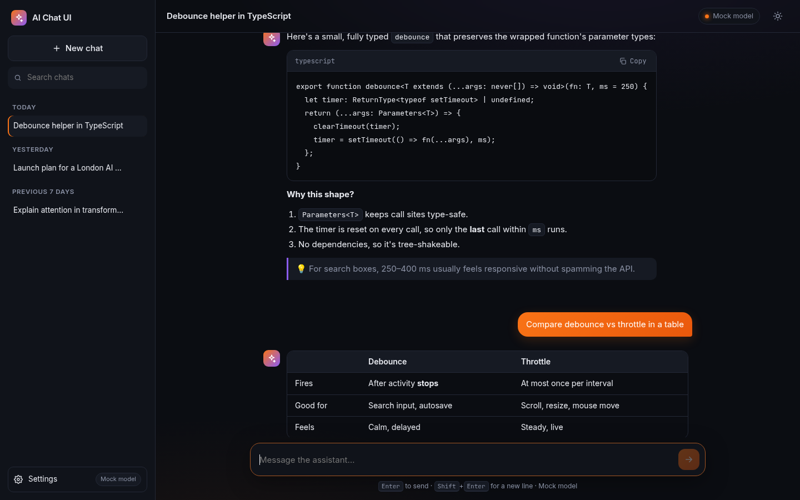
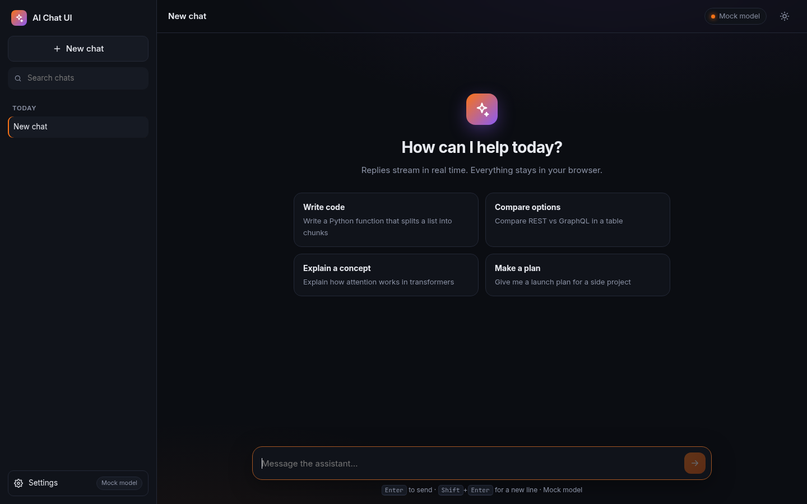

<div align="center">

# 💬 ai-chat-ui

**A polished, streaming chat interface for LLMs, built with React, Vite and TypeScript. Works offline with a mock streaming backend, or connects to any OpenAI-compatible API.**

[](https://github.com/hbtabi/ai-chat-ui/actions/workflows/ci.yml)
[](https://github.com/hbtabi/ai-chat-ui/actions/workflows/deploy.yml)


[](LICENSE)

**[Live demo →](https://hbtabi.github.io/ai-chat-ui/)** · [demo with sample chats](https://hbtabi.github.io/ai-chat-ui/?demo)

</div>

Every AI product needs a chat UI, and most open-source ones are either a weekend prototype or a 50-dependency
monolith. **ai-chat-ui** sits in between: a small, readable React codebase with the details that make chat feel
good, such as token-by-token streaming, a stop button, auto-scroll that respects the reader, Markdown with code
copy buttons, and conversations that survive a refresh.

It runs **entirely in the browser**. The default **mock backend** streams realistic Markdown replies with no network
or API key, so it deploys to GitHub Pages as a static site. Switch to any **OpenAI-compatible endpoint**
(OpenAI, Groq, OpenRouter, Together, Ollama, LM Studio) from the Settings panel.

## 📸 Screenshots

<p align="center"></p>

<p align="center"></p>

## ✨ Features

- **Real streaming**: a hand-written SSE reader for OpenAI-style `stream: true` responses (handles split chunks,
  CRLF, comments and `[DONE]`), plus a typing indicator and blinking caret
- **Mock streaming backend**: intent-aware Markdown replies (code, tables, explanations, checklists) streamed
  token by token with realistic jitter; speed adjustable in Settings
- **Stop & regenerate**: abort mid-stream via `AbortController`; regenerate the last answer
- **Markdown rendering** with GFM (tables, task lists, strikethrough), code blocks with language label and
  **copy** button. Rendered as React elements, never `innerHTML`, so model output can't inject scripts
- **Conversation history in localStorage**: auto titles, grouped by Today / Yesterday / Previous 7 days, search,
  delete, export to JSON, clear all; corrupt storage is ignored instead of crashing
- **Settings**: provider, base URL, API key, model, temperature, system prompt, mock speed
- **Polish**: dark & light themes, responsive layout with a slide-in sidebar on mobile, keyboard shortcuts
  (<kbd>Enter</kbd> to send, <kbd>Shift</kbd>+<kbd>Enter</kbd> for a new line), smart auto-scroll, reduced-motion support
- **`?demo` URL flag** loads sample conversations for a quick tour
- **Tested** with Vitest + Testing Library: SSE parsing, providers, reducer, storage and full UI flows

## 🚀 Quick start

```bash
git clone https://github.com/hbtabi/ai-chat-ui.git
cd ai-chat-ui
npm install
npm run dev          # http://localhost:5173 (mock backend, no key needed)
```

```bash
npm test             # 22 tests
npm run build        # production build in dist/
npm run preview      # serve the build at http://localhost:4173/ai-chat-ui/
```

### Connect a real model

Open **Settings → Provider → OpenAI-compatible** and fill in:

| Provider | Base URL | Model example |
|---|---|---|
| OpenAI | `https://api.openai.com/v1` | `gpt-4o-mini` |
| Groq | `https://api.groq.com/openai/v1` | `llama-3.1-8b-instant` |
| OpenRouter | `https://openrouter.ai/api/v1` | `meta-llama/llama-3.1-8b-instruct` |
| Ollama (local) | `http://localhost:11434/v1` | `llama3.2` |
| LM Studio (local) | `http://localhost:1234/v1` | your loaded model |

Keys are stored only in your browser's localStorage and sent directly to the endpoint you choose. For local
development you can also set defaults in `.env.local` (see [`.env.example`](.env.example)). Don't bake a real key
into a public build, because `VITE_*` variables end up in the JavaScript bundle.

> Local servers need CORS enabled for the page's origin (e.g. `OLLAMA_ORIGINS=*` for Ollama).

### Deploy to GitHub Pages

1. Push to `main` on GitHub.
2. In **Settings → Pages**, set **Source** to **GitHub Actions** (one-time).
3. The [`deploy.yml`](.github/workflows/deploy.yml) workflow tests, builds with the right base path and publishes
   to `https://<user>.github.io/ai-chat-ui/`.

## 🗂️ Project structure

```
ai-chat-ui/
├── src/
│   ├── App.tsx                 # layout, theme, auto-scroll, settings wiring
│   ├── hooks/useChat.ts        # send / stream / stop / regenerate + persistence
│   ├── lib/
│   │   ├── providers.ts        # ChatProvider interface, MockProvider, OpenAICompatibleProvider
│   │   ├── mockReplies.ts      # offline intent-based Markdown replies + lossless tokenizer
│   │   ├── sse.ts              # Server-Sent Events reader
│   │   ├── chatReducer.ts      # pure state transitions
│   │   ├── storage.ts          # localStorage persistence, export
│   │   ├── title.ts            # auto titles, date grouping
│   │   └── demo.ts             # ?demo sample conversations
│   ├── components/             # Sidebar, MessageItem, Markdown, Composer, EmptyState, SettingsDialog, icons
│   └── styles/app.css          # design tokens, dark/light themes, responsive layout
├── test/                       # Vitest + Testing Library
├── docs/                       # screenshots
└── .github/workflows/          # CI + GitHub Pages deploy
```

## 🛣️ Roadmap

- [ ] Syntax highlighting with a lazy-loaded highlighter
- [ ] Edit and resend a previous user message (branching)
- [ ] Image and file attachments for vision models
- [ ] Token usage and cost estimates per conversation
- [ ] Optional sync of conversations via IndexedDB export/import

## 📄 Licence

[MIT](LICENSE) © 2026 Mohammed Hassan bin Tayyeb · Built in London at [Hasenix](https://github.com/hbtabi).
